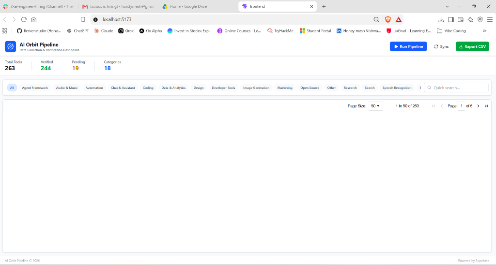
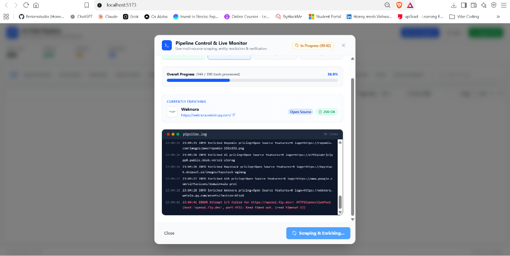

# AI Orbit Pipeline & InternAtlas Suite (Flerken Studio)

<p align="center">
  <strong>Unified multi-pipeline data ingestion engine, ATS scraper, official link verifier, and interactive React dashboard powering AI Orbit &amp; InternAtlas (Flerken Studio).</strong>
</p>

<p align="center">
  <a href="https://buymeacoffee.com/flerken"></a>
  
  
  
  
  
  
</p>

---

## Table of Contents
- [Platform Overview (4 Integrated Modules)](#platform-overview-4-integrated-modules)
- [System Architecture](#system-architecture)
- [Module 1: AI Tools Catalog (`src/`)](#module-1-ai-tools-catalog-src)
- [Module 2: Competitions & Hackathons with Official URL Resolver (`internatlas/competitions/`)](#module-2-competitions--hackathons-with-official-url-resolver-internatlascompetitions)
- [Module 3: Substack Internships — Word (.docx) & Multi-ATS Scraper (`internatlas/substack/`)](#module-3-substack-internships--word-docx--multi-ats-scraper-internatlassubstack)
- [Module 4: Flerken Studio Bot (`flerken-studio-bot/`)](#module-4-flerken-studio-bot-flerken-studio-bot)
- [Live Interactive Web Dashboard](#live-interactive-web-dashboard)
- [REST API Reference](#rest-api-reference)
- [Project Directory Structure](#project-directory-structure)
- [Quick Start Guide](#quick-start-guide)
  - [1. Prerequisites & Environment](#1-prerequisites--environment)
  - [2. Full Web Application (Backend + Frontend)](#2-full-web-application-backend--frontend)
  - [3. CLI Execution Commands](#3-cli-execution-commands)
- [Running Automated Tests](#running-automated-tests)
- [Support & Donations](#support--donations)
- [License](#license)

---

## Platform Overview (4 Integrated Modules)

This repository combines **four specialized data collection, verification, and publishing pipelines** into a single FastAPI backend (`server.py`) and a unified 4-tab React 19 dashboard (`frontend/`):

| Dashboard Tab | Package / Directory | Primary Purpose | Output Formats |
|---|---|---|---|
| **1. AI Tools Catalog** | `src/` | Discovers, scrapes, classifies, and deduplicates AI tools toward a 50,000-tool catalog. | `.csv`, `.xlsx`, `.json`, Supabase |
| **2. Competitions & Hackathons** | `internatlas/competitions/` | Scrapes national & global hackathons/competitions and resolves **official college/company website URLs** (replacing Unstop/Devfolio aggregator links). | `.xlsx`, SQLite (`competitions.db`) |
| **3. Substack Internships (Word / Docx)** | `internatlas/substack/` | Scrapes **98 official ATS boards** (Greenhouse, Lever, Ashby, SmartRecruiters, Workday) and generates ready-to-publish **Word (`.docx`)** documents with clickable links. | `.docx`, `.xlsx`, `.md`, SQLite (`substack_jobs.db`) |
| **4. Flerken Studio Bot** | `flerken-studio-bot/` | Automated Substack newsletter bot for `flerkenstudio.substack.com` with live HTTP link verification, SQLite `SeenStore` ledger, Review Queue safety gate, and unpublished Substack draft creation. | `.md`, `.docx`, `verified_jobs.json`, `review_queue.json`, SQLite (`seen.sqlite3`) |

---

## System Architecture

```
┌───────────────────────────────────────────────────────────────────────────────────┐
│                        React 19 + Vite + AG Grid Dashboard                        │
│  [1. AI Tools Catalog] [2. Competitions] [3. Substack Word/Docx] [4. Flerken Bot] │
└───────────────┬──────────────────┬─────────────────────┬──────────────────┬───────┘
                │                  │                     │                  │
                ▼                  ▼                     ▼                  ▼
┌───────────────────────────────────────────────────────────────────────────────────┐
│                          FastAPI Backend Server (server.py)                       │
│   /api/tools, /api/pipeline   /api/competitions     /api/substack   /api/flerken-bot│
└───────────────┬──────────────────┬─────────────────────┬──────────────────┬───────┘
                │                  │                     │                  │
                ▼                  ▼                     ▼                  ▼
        ┌───────────────┐  ┌───────────────┐     ┌───────────────┐  ┌───────────────┐
        │ AI Orbit Core │  │ Competitions  │     │ Multi-ATS 98  │  │ Flerken Bot   │
        │  9-Stage ETL  │  │ + Official URL│     │ Board Scraper │  │ Link Verifier │
        │   Pipeline    │  │   Resolver    │     │ + Word .DOCX  │  │ + Seen Ledger │
        └───────────────┘  └───────────────┘     └───────────────┘  └───────────────┘
```

---

## Module 1: AI Tools Catalog (`src/`)

- **Multi-Source Discovery Engine**: Ingests candidates across GitHub Search API, Hugging Face Hub Spaces API, Hacker News Algolia API, Curated Awesome-AI markdown registries, and seed directories.
- **Incremental Accumulation (50K Target)**: Accumulates toward the **50,000 AI Tools** milestone across repeated batch runs using Supabase table upserts and cumulative JSON/CSV merges without wiping historic data.
- **High-Concurrency Parallel Scraping**: Concurrent `ThreadPoolExecutor` worker pool probes and enriches 20+ candidate websites simultaneously.
- **Deep Feature & Pricing Extraction**:
  - **Pricing Model**: Classifies tools as `Freemium`, `Open Source`, `Free`, or `Paid`.
  - **Key Features & Social Links**: Extracts core value propositions, official GitHub repos, Discord communities, Twitter/X profiles, and documentation links.
  - **Resilient Logos**: Priority search (`apple-touch-icon`, `og:image`, SVG) with high-res Google Favicon fallback.
- **Entity Resolution & Deduplication**:
  - **Domain-First Identity**: Canonical registrable domain serves as primary identity.
  - **Fuzzy Name Matching**: RapidFuzz (token-sort ratio $\ge 92$) catches near-duplicates and merges metadata.

---

## Module 2: Competitions & Hackathons with Official URL Resolver (`internatlas/competitions/`)

Scrapes live student hackathons, case competitions, fellowships, and engineering challenges while ensuring **every listing links directly to the official college, IIT/NIT/IIM, or corporate organizer website** rather than aggregator URLs.

- **Official Website URL Resolution (`internatlas/competitions/url_resolver.py`)**:
  - Automatically detects aggregator domains (`unstop.com`, `dare2compete.com`, `devfolio.co`, `devpost.com`, `hackerearth.com`, `mlh.io`).
  - Resolves over **140+ known universities, IITs, NITs, IIITs, IIMs, and tech companies** directly to their official `.ac.in`, `.edu.in`, `.edu`, or corporate domains.
  - Falls back to live DuckDuckGo HTML search resolution when an unknown college or company organizer is encountered, and repairs any existing aggregator rows in SQLite on startup (`repair_existing_db_urls`).
- **Structured Classification**: Categorizes each opportunity by `Domain`, `Category`, `Format / Mode`, `Eligibility`, `Prize Pool`, `Deadline`, and `Official Registration Link`.

---

## Module 3: Substack Internships — Word (.docx) & Multi-ATS Scraper (`internatlas/substack/`)

Designed specifically for **InternAtlas Substack issues**, this module scrapes live early-career roles across **98 company ATS boards** and exports a formatted **Microsoft Word (`.docx`)** document matching the exact InternAtlas newsletter layout.

- **5 Official ATS Integrations (`internatlas/substack/scrapers.py`)**:
  1. **Greenhouse API** (`boards-api.greenhouse.io`)
  2. **Lever Postings API** (`api.lever.co`)
  3. **Ashby HQ GraphQL API** (`jobs.ashbyhq.com`)
  4. **SmartRecruiters Postings API** (`api.smartrecruiters.com`)
  5. **Workday CXS JSON API** (`myworkdayjobs.com`)
- **6 Curated InternAtlas Categories (`internatlas/substack/processor.py`)**:
  1. *Software Development & Core Engineering Opportunities*
  2. *Artificial Intelligence & Machine Learning Opportunities*
  3. *Cybersecurity Opportunities*
  4. *Data Analytics, Research & Intelligence Roles*
  5. *Product Design, Media & Content Strategy Roles*
  6. *Business Operations, HR, Marketing & Strategy Roles*
- **Formatted Word (`.docx`) Export (`internatlas/substack/exporter.py`)**:
  - Generates the exact header (`🔴 InternAtlas — {Date} — {N} Verified Internships`), company subtitle list, intro greeting, numbered category items with **clickable blue hyperlinks** (`Title — Company (Location · Work Mode)`), and closing disclaimer.

---

## Module 4: Flerken Studio Bot (`flerken-studio-bot/`)

An automated newsletter issue generator and link-verification bot built for **`https://flerkenstudio.substack.com/`**.

### How Flerken Studio Bot Works
1. **Configurable Source Collection (`src/flerken_bot/sources.py` & `config/sources.yaml`)**:
   - Collects live openings concurrently from enabled **Greenhouse** boards, **Lever** sites, and **RSS/Atom** feeds configured in `flerken-studio-bot/config/sources.yaml`.
   - Manage sources directly from the **Sources & Config** sub-tab in the web UI (toggle boards on/off, add new Greenhouse/Lever/RSS feeds, or remove entries).
2. **Target Location & Early-Career Filtering (`src/flerken_bot/quality.py`)**:
   - Filters for **India** (`Bengaluru`, `Hyderabad`, `Pune`, `Mumbai`, `Delhi/NCR`, `Chennai`, etc.) and **Remote/Global** early-career, internship, graduate, apprentice, trainee, and analyst roles.
3. **Live HTTP Link Verification & Safety Gate (`src/flerken_bot/quality.py`)**:
   - Concurrently verifies every candidate URL via HTTP (`verify_jobs_concurrent`).
   - **Verified Official Links (`verified_link`)**: Confirmed employer URLs (`HTTP < 400`) enter the newsletter issue and `output/verified_jobs.json`.
   - **Review Queue Safety Gate (`needs_review` / `rejected`)**: Aggregator-only links without an explicit official employer URL or unreachable links (`HTTP >= 400`) are **never published as verified links**; they are isolated in `output/review_queue.json` and displayed in the **Review Queue** tab.
4. **Cross-Issue SQLite Deduplication (`state/seen.sqlite3`)**:
   - `SeenStore` records SHA-256 hashes of drafted job URLs so subsequent runs only include newly discovered roles (with a 1-click **Reset** or **Ignore Seen Ledger** option in the UI).
5. **Safe Substack Draft Workflow (`src/flerken_bot/cli.py`)**:
   - Generates both **Substack Markdown (`.md`)** and **Microsoft Word (`.docx`)** files in `flerken-studio-bot/output/`.
   - **Does NOT auto-publish to subscribers**: Clicking **Substack Draft** (or setting `CREATE_SUBSTACK_DRAFT=true`) uses `python-substack` CLI strictly to create an **unpublished draft** in your Substack dashboard for human review.
   - Includes `.github/workflows/newsletter.yml` for scheduled alternate-day execution (`30 3 * * *` / 9:00 AM IST).

---

## Live Interactive Web Dashboard

The React 19 dashboard (`http://localhost:5173`) provides a unified control center across all four modules:

- **Tab 1 — AI Tools Catalog**: AG Grid spreadsheet with category pills, search filter, Single-URL Scraper modal, and live SSE Pipeline Runner modal.
- **Tab 2 — Competitions & Hackathons (InternAtlas)**: Live scraper trigger, domain/mode filters, direct verified college/company website links, and `.xlsx` export.
- **Tab 3 — Substack Internships (Word / Docx)**: Live 98-board ATS scraper progress bar, formatted Substack document preview, 1-click **Download Word (`.docx`)**, **Download Excel (`.xlsx`)**, and **Copy Markdown**.
- **Tab 4 — Flerken Studio Bot**:
  - **Latest Newsletter Issue (`.md`)**: Copy Markdown, download `.MD Issue`, download `Word (.docx)`, or trigger `Substack Draft`.
  - **Verified Official Jobs**: Searchable table of HTTP-verified roles (`verified_link`) with direct employer links.
  - **Review Queue (`review_queue.json`)**: Inspects blocked aggregator or broken links with their `verification_note`.
  - **Sources & Config (`config/sources.yaml`)**: Add, delete, or toggle Greenhouse, Lever, and RSS sources live from the browser.

<p align="center">
  
</p>

<p align="center">
  
</p>

---

## REST API Reference

| Endpoint | Method | Module | Description |
|---|---|---|---|
| `/api/tools` | `GET` | AI Tools | Returns all deduplicated AI tools with categories, pricing, and features. |
| `/api/pipeline/run` | `POST` | AI Tools | Starts the 9-stage AI tools ingestion pipeline in background. |
| `/api/pipeline/stream` | `GET` | Global SSE | Server-Sent Events stream for real-time progress across pipelines. |
| `/api/competitions` | `GET` | Competitions | Lists all hackathons & competitions with resolved official organizer URLs. |
| `/api/competitions/run` | `POST` | Competitions | Runs multi-source competition scraping + official URL resolution. |
| `/api/competitions/download` | `GET` | Competitions | Downloads latest formatted Competitions `.xlsx` workbook. |
| `/api/substack/jobs` | `GET` | Substack Docx | Returns all categorized ATS internships and formatted Markdown preview. |
| `/api/substack/run` | `POST` | Substack Docx | Scrapes 98 ATS boards and generates `.docx` and `.xlsx` exports. |
| `/api/substack/download-docx` | `GET` | Substack Docx | Downloads the latest formatted Microsoft Word (`.docx`) newsletter file. |
| `/api/substack/download-xlsx` | `GET` | Substack Docx | Downloads the latest Substack Internships `.xlsx` spreadsheet. |
| `/api/flerken-bot/state` | `GET` | Flerken Bot | Returns bot status, `sources.yaml`, `SeenStore` count, latest `.md`, verified jobs, and review queue. |
| `/api/flerken-bot/run` | `POST` | Flerken Bot | Runs Flerken Studio Bot collection, concurrent HTTP verification, and `.md`/`.docx` generation. |
| `/api/flerken-bot/sources` | `POST` | Flerken Bot | Toggles, adds, or removes Greenhouse, Lever, or RSS sources in `config/sources.yaml`. |
| `/api/flerken-bot/reset-seen` | `POST` | Flerken Bot | Clears `flerken-studio-bot/state/seen.sqlite3` ledger. |
| `/api/flerken-bot/create-draft`| `POST` | Flerken Bot | Creates an unpublished draft on `flerkenstudio.substack.com` via `python-substack`. |
| `/api/flerken-bot/download/{fmt}`| `GET` | Flerken Bot | Downloads latest Flerken Studio Bot output (`md`, `docx`, or `review`). |

---

## Project Directory Structure

```text
ai-orbit-pipeline/
├── src/                          # Module 1: AI Tools 9-stage ingestion pipeline
│   ├── discovery/                # GitHub, HuggingFace, HackerNews, Awesome-AI, Seed
│   ├── extraction/               # Parallel scraper, pricing, features, logos
│   ├── cleaning/                 # HTML sanitizer, URL canonicalizer
│   ├── normalization/            # Entity name cleaner & deterministic UUIDv5
│   ├── deduplication/            # Domain-first + RapidFuzz entity resolution
│   ├── classification/           # Taxonomy category mapper
│   ├── relationships/            # Knowledge graph edge builder
│   ├── validation/               # Quality gate validator
│   └── export/                   # CSV, JSON, Excel, and Supabase exporters
├── internatlas/
│   ├── competitions/             # Module 2: Competitions & Hackathons + Official URL Resolver
│   │   ├── url_resolver.py       # Resolves aggregator links to official college/company websites
│   │   ├── scrapers.py           # Unstop, Devpost, MLH, Kaggle, HackerEarth, Curated scrapers
│   │   ├── processor.py          # Deduplication, classification & quality scoring
│   │   └── exporter.py           # Styled Excel (.xlsx) exporter
│   └── substack/                 # Module 3: Substack Internships (98 ATS Boards -> Word .docx)
│       ├── companies.yaml        # 98 curated Greenhouse, Lever, Ashby, SmartRecruiters, Workday boards
│       ├── scrapers.py           # Concurrent multi-ATS JSON/GraphQL adapters
│       ├── processor.py          # Early-career filter, India/Remote filter, 6-category mapper
│       └── exporter.py           # python-docx Word (.docx) generator with clickable hyperlinks
├── flerken-studio-bot/           # Module 4: Flerken Studio Bot (Substack Newsletter Bot)
│   ├── config/sources.yaml       # Configurable Greenhouse, Lever & RSS sources
│   ├── src/flerken_bot/          # Bot package (cli.py, sources.py, quality.py, render.py, models.py)
│   ├── tests/test_quality.py     # Unit tests for verification, deduplication, SeenStore & rendering
│   └── .github/workflows/        # Alternate-day GitHub Actions workflow (newsletter.yml)
├── frontend/                     # React 19 + Vite + Tailwind + AG Grid Web Dashboard
│   └── src/
│       ├── App.jsx               # Main 4-tab application shell
│       └── components/           # CompetitionsView.jsx, SubstackView.jsx, FlerkenBotView.jsx, etc.
├── server.py                     # Unified FastAPI server powering all 4 modules
├── run.py                        # CLI runner for AI Tools pipeline
└── requirements.txt              # Python dependencies
```

---

## Quick Start Guide

### 1. Prerequisites & Environment

- **Python 3.10+**
- **Node.js 18+** & **npm**

Clone the repository and configure environment variables:

```bash
git clone https://github.com/flerkenstudio/ai-orbit-pipeline.git
cd ai-orbit-pipeline

# Copy environment template
cp .env.example .env
```

Set up the Python virtual environment and install dependencies:

```bash
python -m venv venv
source venv/bin/activate       # On Windows: .\venv\Scripts\activate
pip install -r requirements.txt
```

---

### 2. Full Web Application (Backend + Frontend)

#### Terminal 1 — Start FastAPI Server (Port 8000)
```bash
# Activate virtual environment
source venv/bin/activate       # On Windows: .\venv\Scripts\activate

# Run FastAPI server
python server.py
```

#### Terminal 2 — Start Frontend Dashboard (Port 5173)
```bash
cd frontend
npm install
npm run dev
```

Open **`http://localhost:5173`** in your browser to access all 4 tabs (**AI Tools Catalog**, **Competitions & Hackathons**, **Substack Internships (Word / Docx)**, and **Flerken Studio Bot**).

---

### 3. CLI Execution Commands

You can also run each module standalone from the command line:

```bash
# 1. Run AI Tools Ingestion Pipeline
python run.py

# 2. Run Substack Multi-ATS Scraper & Word (.docx) Exporter
python -m internatlas.substack.pipeline

# 3. Run Flerken Studio Bot (Dry-Run: generates .md, .docx, verified_jobs.json & review_queue.json)
PYTHONPATH=flerken-studio-bot/src python -m flerken_bot.cli run \
  --config flerken-studio-bot/config/sources.yaml \
  --output flerken-studio-bot/output \
  --state-db flerken-studio-bot/state/seen.sqlite3 \
  --dry-run
```

---

## Running Automated Tests

Run both the core pipeline test suite and the Flerken Studio Bot unit test suite with `pytest`:

```bash
# Core AI Orbit Pipeline unit tests (12 tests)
pytest tests/ -v

# Flerken Studio Bot unit tests (6 tests)
PYTHONPATH=flerken-studio-bot/src pytest flerken-studio-bot/tests/test_quality.py -v
```

---

## Support & Donations

If you find this project helpful, please consider supporting its development:

<p align="left">
  <a href="https://buymeacoffee.com/flerken">
    
  </a>
</p>

- **Buy Me a Coffee**: [buymeacoffee.com/flerken](https://buymeacoffee.com/flerken)

---

## License

MIT License — free for educational and commercial use.
